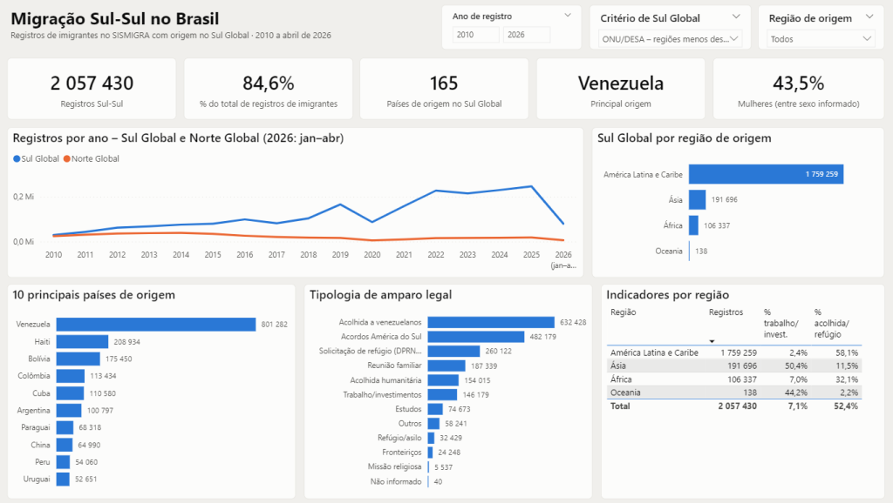
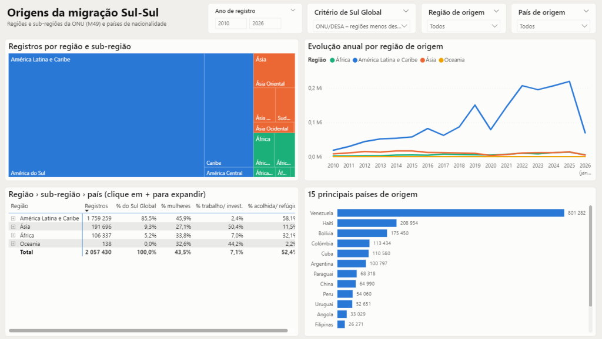
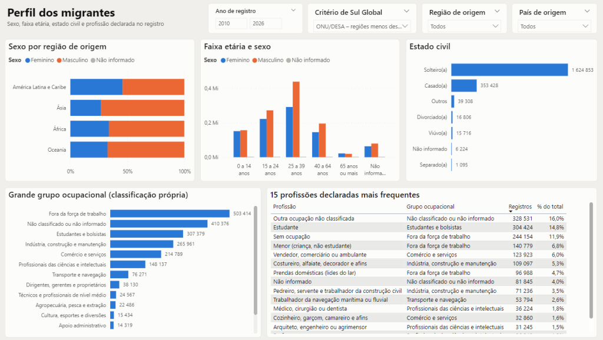
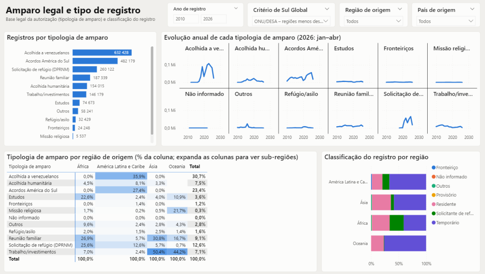
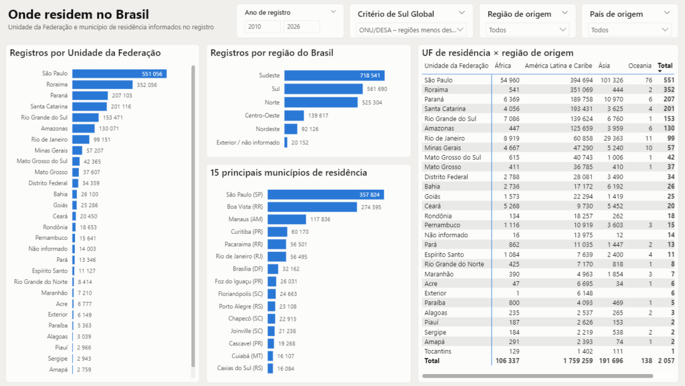
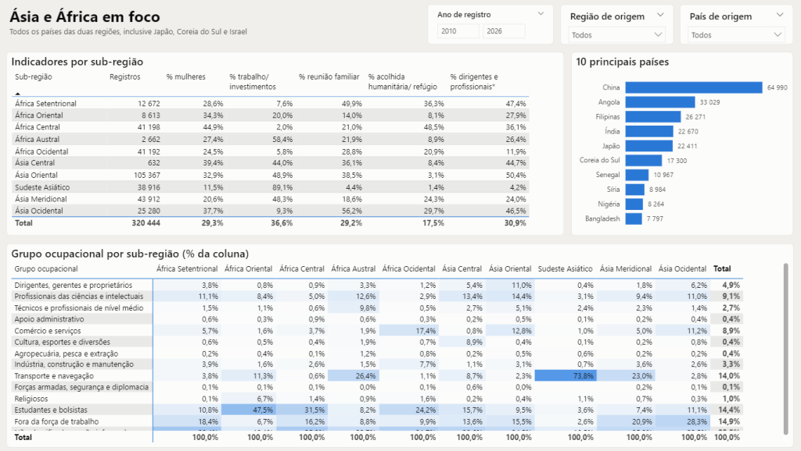

# Migração Sul-Sul no Brasil – painel Power BI (SISMIGRA)

Painel interativo em Power BI sobre os **registros de imigrantes do SISMIGRA** (Sistema de Registro
Nacional Migratório, Polícia Federal) de 2010 a abril de 2026, com foco na **migração Sul-Sul**: imigrantes
cuja origem está no Sul Global. Inclui uma página dedicada à comparação entre **Ásia e África**.

Tudo é reprodutível: um script em Python harmoniza os microdados e outro gera o modelo do Power BI.



## Alguns números (2010 – abr. 2026)

- **2.057.430** registros de imigrantes com origem no Sul Global, ou **84,6%** de todos os registros (critério ONU/DESA).
- A Venezuela responde por 39% deles; América Latina e Caribe somam 1,76 milhão, a Ásia 192 mil e a África 106 mil.
- Mais da metade dos registros asiáticos tem amparo de trabalho ou investimentos (50,4%), contra 7,0% dos africanos
  e 2,4% dos latino-americanos, entre os quais predominam acolhida humanitária e refúgio (58,1%).
- Entre quem declarou ocupação no mercado de trabalho, dirigentes e profissionais de nível superior são
  50,4% na Ásia Oriental (incluindo Japão e Coreia do Sul) e 4,2% no Sudeste Asiático, onde 74% de todos os
  registros estão no grupo transporte e navegação.

Os números contam **registros** por ano de registro, não pessoas únicas nem entradas no país.

## Páginas

| | |
|---|---|
| **1. Visão geral**: totais, série anual Sul × Norte, regiões, principais países, tipologia de amparo | **2. Origens**: regiões e sub-regiões da ONU, evolução anual, matriz região › sub-região › país |
|  |  |
| **3. Perfil**: sexo, faixa etária, estado civil, grupo ocupacional e profissões | **4. Amparo legal**: tipologias, evolução de cada uma e distribuição por região |
|  |  |
| **5. Destinos no Brasil**: UF, região e municípios de residência | **6. Ásia e África**: indicadores e grupos ocupacionais por sub-região |
|  |  |

A página 7 traz as notas metodológicas. Um seletor no topo troca o **critério de Sul Global** (ONU/DESA ou UNCTAD).

## Como usar

Requisitos: [Power BI Desktop](https://powerbi.microsoft.com/desktop/) (Windows, gratuito) e Python 3 com `pandas`.

1. **Baixe os microdados do SISMIGRA** no [Portal de Imigração do OBMigra/MJSP](https://portaldeimigracao.mj.gov.br/)
   (Dados › Microdados › SISMIGRA) e salve os CSV em [`dados/`](dados/) com nomes no formato `sismigra_*.csv`
   (ex.: `sismigra_2024.csv`; para ano incompleto, `sismigra_janeiro_abril_2026.csv`).
2. **Prepare as tabelas** (gera `tabelas/`, cerca de 1–2 minutos):
   ```powershell
   pip install pandas
   python preparar_dados.py
   ```
3. **Abra o painel**: dois cliques em `Painel_Migracao_Sul-Sul_SISMIGRA.pbit`. O Power BI pede o parâmetro
   *PastaTabelas*; informe o caminho completo da pasta `tabelas` deste repositório (o padrão é
   `C:\painel-sul-sul-sismigra\tabelas`, que funciona se você clonar o repositório em `C:\`). Clique em
   **Carregar** e depois salve como `.pbix`.

Para atualizar com dados novos, coloque os CSV em `dados/`, rode `preparar_dados.py` de novo e clique em
**Atualizar** no Power BI. Para mudar medidas, visuais ou layout, edite e rode `gerar_pbit.py`, que regera o `.pbit`.

## Metodologia

- **País de referência**: nacionalidade. O arquivo 2010–2017 não traz nacionalidade para o ano de 2017
  (102.721 registros); para ele usa-se o país de nascimento, que coincide com a nacionalidade em 97,6% dos
  registros dos demais anos.
- **Região**: o campo `CONTINENTE` do SISMIGRA é inconsistente e foi descartado. Região e sub-região vêm da
  classificação **M49 da ONU** aplicada ao país ([`referencias/paises.csv`](referencias/paises.csv)); as
  ~300 grafias do SISMIGRA são unificadas em [`referencias/paises_variantes.csv`](referencias/paises_variantes.csv).
- **Sul Global – ONU/DESA (padrão)**: todos os países exceto Europa, América do Norte (EUA, Canadá, Bermudas,
  Groenlândia), Austrália, Nova Zelândia e Japão (as "regiões mais desenvolvidas" da Divisão de População da ONU).
- **Sul Global – UNCTAD**: como o anterior, tratando também Israel, Coreia do Sul e Chipre como economias desenvolvidas.
- **Ásia e África**: a página 6 inclui todos os países dessas regiões, sem aplicar o critério, para comparar a
  Ásia Oriental (China, Japão, Coreias, Taiwan) com o restante da Ásia e com a África.
- **Solicitação de refúgio (DPRNM)**: o SISMIGRA rotula como "Não aplicável" os registros com amparo 290
  (art. 2º do Decreto 9.277/2018), o documento provisório do solicitante de refúgio. Aqui eles foram
  renomeados e entram no indicador de acolhida humanitária e refúgio.
- **Profissões**: 169 grafias (inclusive as truncadas do arquivo 2010–2017) foram padronizadas em 95
  profissões e 14 grandes grupos, em **classificação própria** inspirada nos grandes grupos da CBO/ISCO
  ([`referencias/profissoes.csv`](referencias/profissoes.csv)). O indicador "% dirigentes e profissionais" usa como
  base apenas os registros com ocupação declarada no mercado de trabalho.

As classificações são arquivos CSV editáveis: discorda de uma escolha? Edite o CSV e rode o script de novo.

## Estrutura

| Arquivo | Conteúdo |
|---|---|
| `Painel_Migracao_Sul-Sul_SISMIGRA.pbit` | Modelo do Power BI (sem dados): 8 tabelas, 30 medidas DAX, 7 páginas |
| `preparar_dados.py` | Harmoniza os microdados e grava o fato agregado e as dimensões em `tabelas/` |
| `gerar_pbit.py` | Gera o `.pbit` a partir de código (modelo, medidas, visuais e tema) |
| `referencias/` | Classificações de países, grafias e profissões (editáveis) |
| `dados/` | Onde ficam os CSV do SISMIGRA (não versionados) |

## Licença e citação

- Código (`*.py`): [MIT](LICENSE).
- Tabelas de referência, painel e textos: [CC BY 4.0](https://creativecommons.org/licenses/by/4.0/deed.pt_BR).

Os microdados do SISMIGRA não são redistribuídos aqui. Ao usar o painel, cite-o (botão *Cite this repository*
ao lado, a partir de [`CITATION.cff`](CITATION.cff)) e cite a fonte dos dados: SISMIGRA, Polícia Federal /
Ministério da Justiça e Segurança Pública.

---

**English summary.** Power BI dashboard on South–South migration to Brazil, built from SISMIGRA immigrant
registration microdata (Brazilian Federal Police, 2010 – Apr 2026). Python scripts harmonise country names
(UN M49), occupations and legal grounds; a generator script builds the `.pbit` template (data model, DAX
measures, report pages). Global South is selectable between the UN DESA and UNCTAD definitions. Code under
MIT, content under CC BY 4.0.
